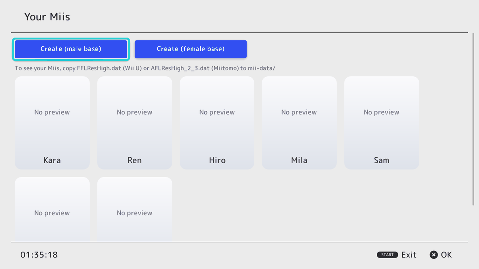
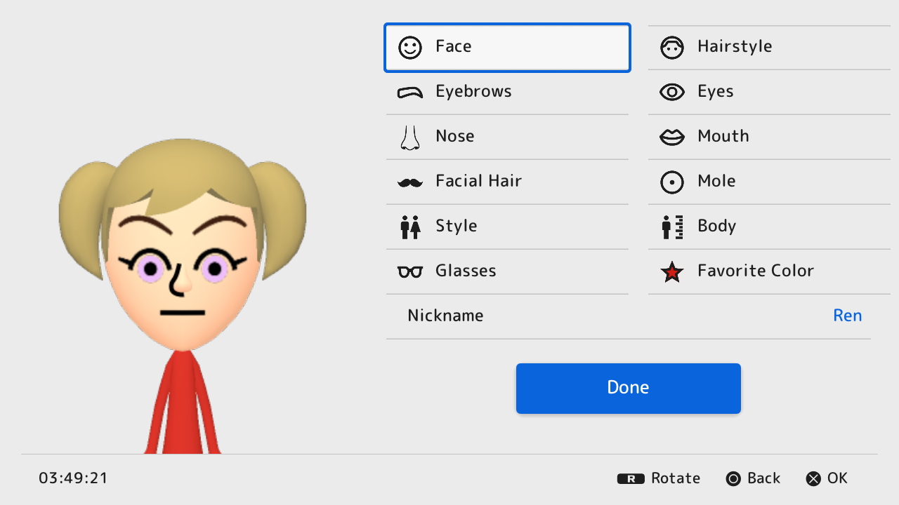
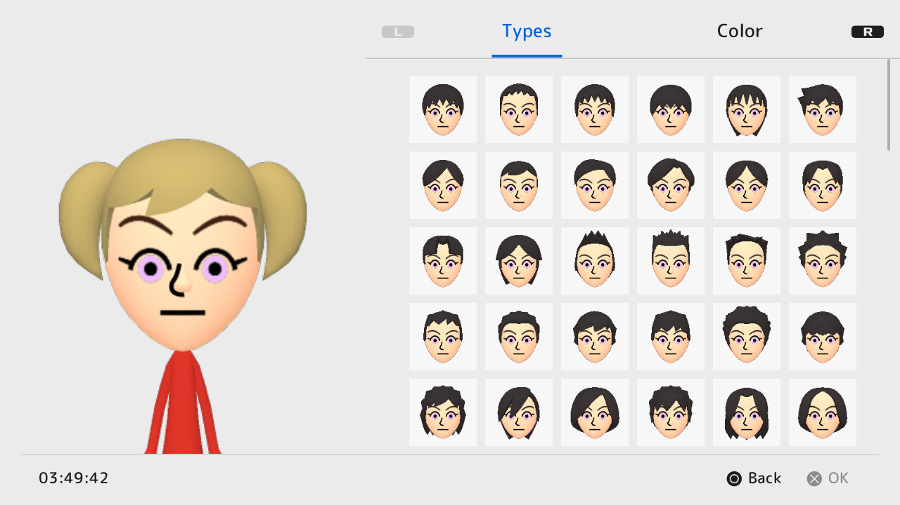
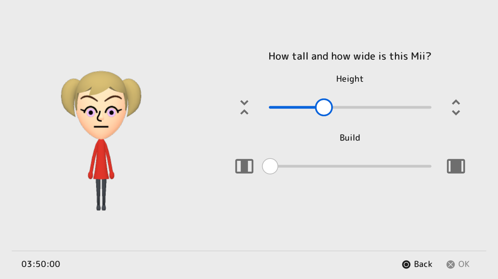

# mii-maker-vita

A Mii editor for the PS Vita, laid out like the Nintendo Switch's Mii editor,
that saves Miis in the **official Switch format**. Other homebrew and game
ports can then use them from a shared database.

| Library | Editor |
| --- | --- |
|  |  |
| **Hairstyles** | **Body** |
|  |  |

Screenshots from the desktop build with `AFLResHigh_2_3.dat` and
`FFLBodyRes.dat` installed.

> **Mii previews** need a face resource from hardware or software you own,
> `AFLResHigh_2_3.dat` (Miitomo) or `FFLResHigh.dat` (Wii U), in
> `ux0:data/mii-maker-vita/dat/`, plus `FFLBodyRes.dat` for whole Miis.
> They are not included. See [3D_RENDERING.md](docs/3D_RENDERING.md).

## What works

- **libmii** (`libmii/`, portable C99): Switch CharInfo / CoreData / StoreData,
  the Switch Mii database (NFDB), 3DS/Wii U/amiibo Ver3StoreData and Mii QR
  code contents (including the Switch 2 extension), all with CRCs and
  validation. Also the Switch palette and the Switch editor's grid
  order. Checked byte-for-byte against [MiiJS](https://github.com/Stewared/MiiJS)
  on hundreds of real Mii files. Also the Wii's Mii format (RFLCharData) and Mii database
  (`RFL_DB.dat`), for ports of Wii games.
- **Editor app** (`app/`, C++ on [borealis](https://github.com/xfangfang/borealis)):
  laid out like the Switch 2 Mii editor: a large preview with a two-column
  category menu, nickname and Done button; each category opens a page with
  Types / Position / Color tabs (L / R) and picture tiles; Style, Body and
  Favorite Color are single prompt pages. The right stick or a finger drag
  turns the Mii; L shows it with an **expression** (a checkmark list: 19
  with an FFLRes, 60 with Miitomo's AFLRes, such as winks, hearts, cat and
  dog; only the preview, Miis have no expression of their own), and R in
  a **pose** (171 of them, waving, bowing, dancing, sitting, lying down...,
  from Mario Kart 8's `MiiBodyMiddle.bfres`: your own copy, from your Wii U,
  in `ux0:data/mii-maker-vita/dat/`; pages with tabs keep L / R for the
  tabs). Cross on a Mii in the list opens it on its own screen: the whole
  Mii to turn, and Edit, Change Expression, Change Pose, View QR Code, Use
  Kid-o-matic and Delete; L / R show the Mii before / after it. The list
  holds 200 Miis. **Photo Studio** (on that screen) poses a Mii with an
  expression on a background of your choice, whole or close up, and saves
  a 960 x 544 PNG to `ux0:picture/MIIMAKER/` for the Photos app (Clear
  gives a see-through background). Each Mii has a **Profile** in the editor
  (beside Nickname): favorite (red pants, as on the Wii U and Switch),
  birthday, creator and mingle, kept in `ux0:data/mii/details.txt` and
  carried into .ffsd / .cfsd files, QR codes and the Wii database. A cog
  button beside Receive Mii opens the settings, as START does.
  "Add Mii" starts from scratch, offers ten look-alikes
  (curated, or any combination at all), and has two generators from
  InfiniMii (ported from MiiJS and checked against it): **Kid-o-matic**
  shows a Mii at six stages of life, newborn to adult, and the **Child
  Generator** makes the child of two Miis at those six stages; each stage
  can be edited and saved. "Receive Mii" scans a **Mii QR code** with the
  back camera (3DS, Wii U, Switch 2 and Tomodachi Life codes), imports
  `.charinfo` / `.nfsd` / `.ffsd` / `.cfsd` files and QR code pictures from
  `ux0:data/mii/import/`, or receives from another Vita; "Send Mii"
  exports Miis to `ux0:data/mii/export/` (several in a row) or makes a QR code (Switch 2
  format, which keeps Switch-only colors; 3DS and Wii U read it too), shown
  on screen and saved to `ux0:data/mii/qr/`. QR codes need your own copy of
  the Mii QR key (not included) in `ux0:data/mii-maker-vita/dat/qrkey.txt`:
  32 hex digits, optionally followed by the Switch 2 key on the next line.
  **Send to / Receive from Another Vita** trades Miis over ad-hoc wireless
  (the receiver is asked before each Mii is saved).
  In the list, Triangle picks a Mii up to move it (Cross places it,
  Triangle swaps it with the Mii under the cursor, Circle puts it back).
  Settings (START): default skin tone, theme, curated look-alikes, QR code
  format, a cache reset, and
  background music from your own Ogg Vorbis files in
  `ux0:data/mii-maker-vita/music/` (`mii_channel.ogg`, `mii_maker_3ds.ogg`,
  `mii_maker_wiiu.ogg`; loop points from `LOOPSTART` / `LOOPLENGTH` or
  `LOOPEND` comments, in samples; not included). Miis are saved to
  `ux0:data/mii/database.nfdb` (the first 100, shared with other apps;
  Miis 101-200 in `database2.nfdb`; the app's own files
  go in `ux0:data/mii-maker-vita/`), and the first 100 also as a Wii Mii
  database, `ux0:data/mii/wii/RFL_DB.dat`, which ports of Wii games can read
  (a Super Mario Galaxy port change for this is in progress). Icons come from openly licensed,
  human-made sets (Material Symbols, Material Design Icons, Health Icons,
  Tabler) and the button glyphs from PromptFont. Every button hint can be
  tapped, and a tap beside a menu closes it. Builds to a `.vpk`, tested
  on a real Vita by the project owner.
- **libmii3d** (`libmii3d/`, C99 + zlib): reads the Wii U and Miitomo face
  resources (including untiling Wii U GPU-tiled textures) and draws a Mii,
  head and (with `FFLBodyRes.dat`) body, with the Switch's lighting model in
  a small software rasterizer, so
  it runs the same on the Vita and on a PC. It also draws FFL's facial
  expressions (the 70 of Miitomo's resource, as FFL sets them up), and
  poses: it reads `MiiBodyMiddle.bfres` (BFRES 3: the rigged bodies and
  their skeletal animations' curves) and draws its body posed at a frame of
  an animation, the head on the head bone.
  On the Vita the app draws with the GPU (GXM) when the shader compiler
  (`libshacccg.suprx`) is installed, otherwise in software on worker threads;
  drawn icons are kept in one cache file.
- **`miitool`**: PC command-line tool to inspect and convert Mii files and
  list a database. **`miirender`** renders a Mii to an image.

## Docs

- [Research notes](docs/RESEARCH.md): Vita UI toolkits, Mii formats, existing
  editors and renderers, licenses, ad-hoc networking, the state of the Mario
  Kart Wii / Mario Galaxy ports.
- [Architecture and roadmap](docs/ARCHITECTURE.md): renderer plan, ad-hoc
  trading design, how games plug in.
- [3D rendering](docs/3D_RENDERING.md): providing the face and body resources, how
  the renderer works.
- [Shared database](docs/SHARED_DATABASE.md): how other apps and game ports
  read players' Miis.
- [Building](docs/BUILDING.md): Vita, desktop and library builds.

## Layout

```
libmii/              C library for the Mii formats (+ miitool, tests, MiiJS vectors)
libmii3d/            3D head renderer for the Wii U face resource (+ miirender, tests)
app/                 the Vita app (borealis UI), its resources and LiveArea
third_party/borealis git submodule (Apache-2.0)
docs/                research, architecture, shared database, building
```

## Legal

Not affiliated with or endorsed by Nintendo. "Mii" and "Nintendo Switch" are
trademarks of Nintendo. This repository and the `.vpk` contain no Nintendo
code, artwork, fonts or sounds: icons and button glyphs come from openly
licensed sets made by people (see the notices), and the fonts are Poppins and
M PLUS Rounded 1c (SIL OFL). The 3D renderer uses the face and
body resource files each user copies from hardware or software they own. Third-party code and
data: [THIRD_PARTY_NOTICES.md](THIRD_PARTY_NOTICES.md).
