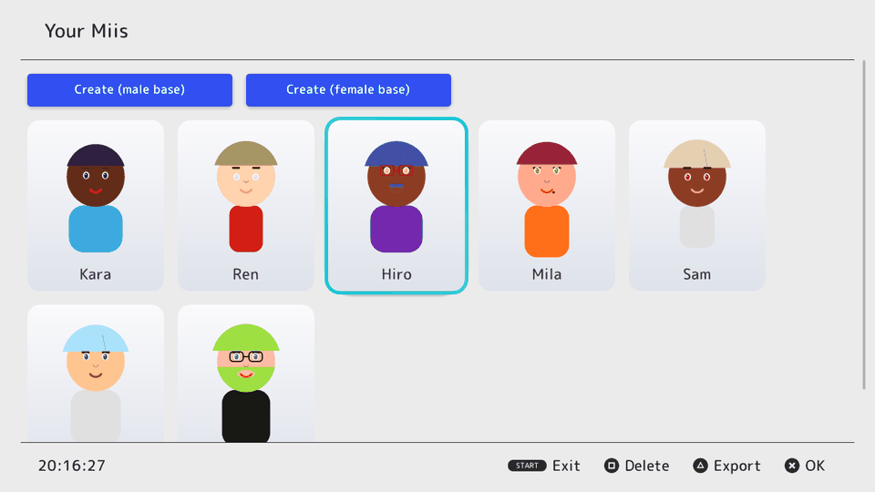
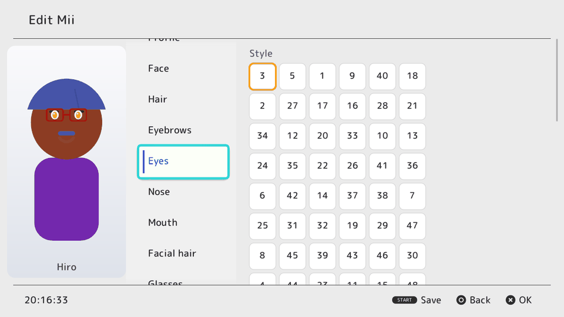

# mii-maker-vita

A Mii editor for the PS Vita, laid out like the Nintendo Switch's Mii editor,
that saves Miis in the **official Switch format**. Other homebrew and game
ports can then use them from a shared database.

| Library | Editor |
| --- | --- |
|  |  |

> The preview is a 2D stand-in until the 3D renderer lands (it reacts to every
> field: positions, sizes and colors). Part grids show numbers for now. See the
> [roadmap](docs/ARCHITECTURE.md#roadmap).

## What works

- **libmii** (`libmii/`, portable C99): Switch CharInfo / CoreData / StoreData,
  the Switch Mii database (NFDB), and 3DS/Wii U/amiibo Ver3StoreData, all with
  CRCs and validation. Also the Switch palette and the Switch editor's grid
  order. Checked byte-for-byte against [MiiJS](https://github.com/Stewared/MiiJS)
  on hundreds of real Mii files.
- **Editor app** (`app/`, C++ on [borealis](https://github.com/xfangfang/borealis)):
  create from a male/female base, all eleven categories (profile, face, hair,
  eyebrows, eyes, nose, mouth, facial hair, glasses, mole, body), save to
  `ux0:data/mii/database.nfdb`, export `.charinfo` / `.nfsd` / `.ffsd`, delete.
  Builds to a `.vpk` (it has not been run on real Vita hardware yet).
- **`miitool`**: PC command-line tool to inspect and convert Mii files and
  list a database.

## Docs

- [Research notes](docs/RESEARCH.md): Vita UI toolkits, Mii formats, existing
  editors and renderers, licenses, ad-hoc networking, the state of the Mario
  Kart Wii / Mario Galaxy ports.
- [Architecture and roadmap](docs/ARCHITECTURE.md): renderer plan, ad-hoc
  trading design, how games plug in.
- [Shared database](docs/SHARED_DATABASE.md): how other apps and game ports
  read players' Miis.
- [Building](docs/BUILDING.md): Vita, desktop and library builds.

## Layout

```
libmii/              C library for the Mii formats (+ miitool, tests, MiiJS vectors)
app/                 the Vita app (borealis UI), its resources and LiveArea
third_party/borealis git submodule (Apache-2.0)
docs/                research, architecture, shared database, building
```

## Legal

Not affiliated with or endorsed by Nintendo. "Mii" and "Nintendo Switch" are
trademarks of Nintendo. This repository and the `.vpk` contain no Nintendo
code, artwork, fonts or sounds: the UI art and button glyphs are original, and
the font is M PLUS Rounded 1c (SIL OFL). The planned 3D renderer will use
resource files that users dump from their own hardware. Third-party code and
data: [THIRD_PARTY_NOTICES.md](THIRD_PARTY_NOTICES.md).
